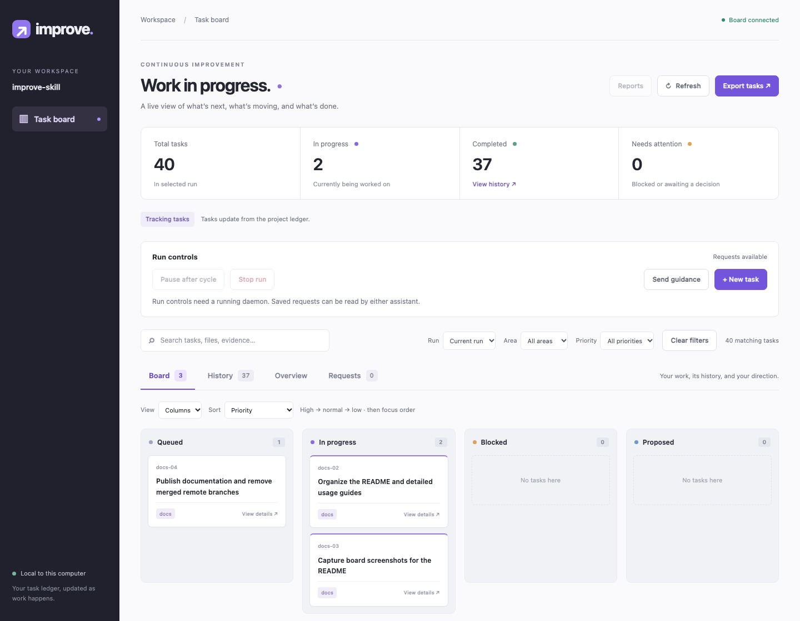
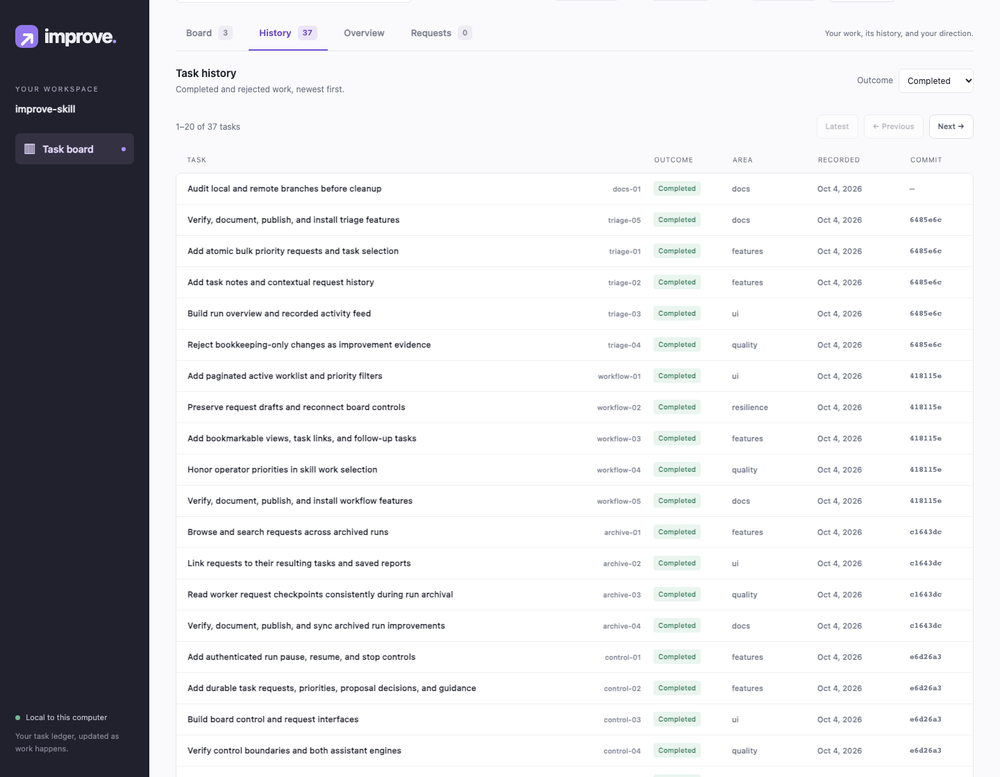
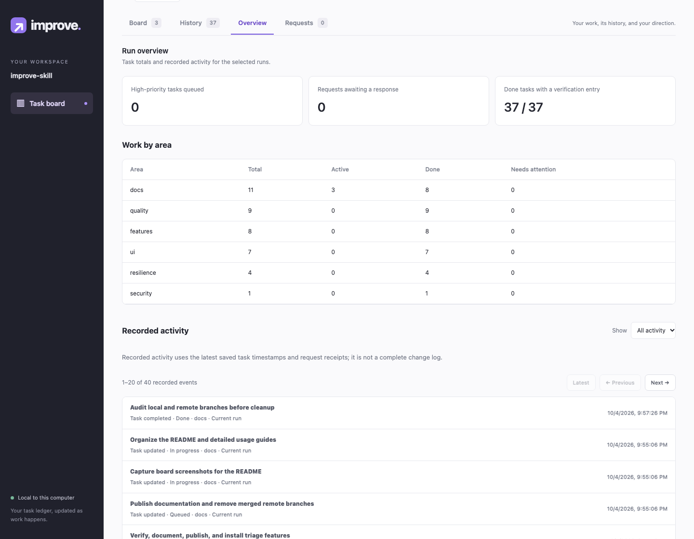

# /improve

**Point an AI coding assistant at your repository, tell it how long to work, and come back
to verified commits.** `/improve` runs inside **Claude Code** or **Codex** and keeps
improving a codebase for the duration you ask for, from ninety minutes to a three-day
weekend. It asks what you care about, finds concrete problems, fixes them one at a time
behind your test suite, and never marks anything done that it could not prove. A local
board shows every task, lets you steer, and tells you at a glance whether the run is
healthy.

```text
Claude Code:  /improve 4h
Codex:        $improve 90m ~/Code/api
Over days:    /improve-max 3d ~/Code/api --target 5x
```

[Get started](#get-started-in-five-minutes) · [What you get](#what-you-get) ·
[The board](#the-board) · [Long unattended runs](#long-unattended-runs) ·
[How it works](#how-a-run-works) · [Improve-max](#improve-max) · [Docs](#documentation)

## What you get

| Capability | What it means |
| --- | --- |
| **Your priorities, not the model's** | Ten short intake questions become an ordered focus plan before the clock starts. Features, UI, assets, performance, bugs, security, and quality can all be in scope. |
| **Proof, not vibes** | Every change runs the repository's own gates, a mutation check that makes the test go red, and an adversarial counter-scenario. Unverified work is reverted and recorded as rejected, with the evidence. |
| **It does not stop early** | An empty backlog triggers a deeper search. Setbacks block one task, never the run. The daemon repairs bad state, survives crashes, parks and retries when the environment misbehaves, and only the deadline ends the run normally. |
| **A board you can steer from** | Columns, history, run health with live heartbeat and cycle ages, notifications, journal and log viewers, voice commands, phone layout, dark mode. Add tasks, change priorities, approve proposals, pause, resume, or stop. |
| **Token-frugal tooling** | Every helper the agent calls answers in TOON (Token-Oriented Object Notation): one header, one row per record. Graph answers are 19-49% smaller than compact JSON and about half the indented JSON they replaced; the ranked backlog view is about 72% smaller than reading the raw ledger. Long answers take a token budget and say what they left out. Storage stays JSON. |
| **Memory across runs** | A knowledge graph of files, tasks, gates, blockers, and recorded lessons that the skill queries before each task and maintains on its own, keeping a history and a write journal so nothing is lost, even when the store is damaged. It knows when the code behind a note has changed, when two notes contradict each other, which advice recent work confirmed, and follows renamed files. |
| **Code awareness** | A standard-library code layer answers "what depends on this?" with the line that uses it, for one file, one function, or the whole uncommitted diff (`impact --changed`), and names the tests that reach the change so they run first (`tests-for`). Python is read with `ast` and Python's own scoping rules (instance, inherited, and `super()` calls; never a guess); JavaScript/TypeScript imports and calls, and Go, Java, Kotlin, Ruby, and C/C++ imports are read too. It also searches code by identifier words, lists import cycles, groups files into modules, and writes a Markdown or GraphML report. |
| **Safe by default** | Never touches `main`, never pushes, never weakens a test, never bumps a dependency or installs tooling, never reads secrets, and strips anything that looks like a credential from what it records. Explicit authorization is remembered and honored within its scope. |

## Get started in five minutes

### 1. Install

You need **Git and Python 3.9+** on macOS or Linux. Background runs also need the
assistant's authenticated CLI (`claude` or `codex`). The board needs nothing else: no npm,
no account, no network.

Clone once and link both skills into each assistant you use:

```sh
improve_checkout="$HOME/Code/improve-skill"
git clone https://github.com/kshaham/improve-skill.git "$improve_checkout"

for improve_skills_dir in "$HOME/.claude/skills" "$HOME/.agents/skills"; do
  mkdir -p "$improve_skills_dir"
  for improve_name in improve improve-max; do
    improve_target="$improve_checkout"
    if [ "$improve_name" = improve-max ]; then improve_target="$improve_checkout/max"; fi
    if [ -e "$improve_skills_dir/$improve_name" ] || [ -L "$improve_skills_dir/$improve_name" ]; then
      printf 'Keeping existing installation: %s\n' "$improve_skills_dir/$improve_name"
    else
      ln -s "$improve_target" "$improve_skills_dir/$improve_name"
    fi
  done
done
```

Existing `~/.codex/skills` installations work too (tested with Codex CLI 0.160.0). Keep one
installation per host so the skill does not appear twice. To update later:

```sh
git -C "$HOME/Code/improve-skill" pull --ff-only
```

### 2. Start a run

Open your repository in Claude Code or Codex with a clean working tree and invoke the skill
with a duration. The path defaults to the current directory.

```text
/improve 4h
$improve 90m ~/Code/api
```

### 3. Answer ten questions

The skill asks what you want most, which features, screens, and assets matter, where it is
slow, what is broken, what must stay untouched, and how you will judge success. Answer all
ten in one message if you like; "none" and "use your judgment" are fine answers. The timer
starts after the intake, and a resumed run never asks again.

### 4. Open the board and let it work

The skill prints a verified local URL, normally `http://127.0.0.1:8765`. The board shows
the queue, the task in progress, blocked and proposed items, completed history with
commits, and a run-health panel. Steer from the browser whenever you like; the skill
applies your requests at its next checkpoint and records a response.

Everything the run knows lives in the target repository's `.improve/` directory, which
should stay out of version control. Review the result with the branch and commands the
final report prints:

```sh
git log --oneline "$baseline_commit..improve/$date"
```

## The board

The board is a local web app served from `127.0.0.1`. It reads the run's ledgers directly,
stays available after the run ends, and includes `improve-max` experiments and archived
runs.



**Work in progress.** Four working columns or a compact worklist; sort and filter by
priority; select up to fifty tasks for a bulk priority change; open any task for its
evidence, acceptance checks, verification, files, notes, and commits. Blocked tasks say
who blocked them, why, and when, and offer a one-click **Retry** once the blocker is gone.

**Run health.** Engine, model, cycle, phase, deadline countdown from the server clock, and
two live ages: time since the supervisor's heartbeat and time the current cycle has run
against its limit, amber at 75% and red past it. Counters for quarantines, recoveries,
crashes, and limit waits, a timeline of the last 24 cycles, and buttons for the hourly
**Journal**, the **Daemon log** tail, and the **Quarantine** refs with their restore
command. Turn on **Notify me** for a browser notification when the run halts, parks, waits
for a usage limit, reaches its deadline, blocks a task, or answers a request.



**History and overview.** Completed and rejected work in searchable, paginated rows with
commits. Totals by area, high-priority queue, pending requests, verified-task counts, and a
browsable activity log, all exportable as JSON.



**Steering.** New tasks and guidance, priorities, proposal decisions, notes, per-area focus
(prefer, normal, skip), twenty improvement-category tiles such as UI polish, security
hardening, scaling, accessibility, or SEO, pause, resume, and stop. Pending requests can be
withdrawn. Drafts survive reloads; task links and views are bookmarkable.

**Knowledge.** The Knowledge tab draws the cross-run graph: files, areas, tasks, gates,
blockers, and recorded knowledge. Search it, pin or correct knowledge, add your own
decisions and conventions (the skill treats them as constraints), and watch it dream:
inferring links with evidence, forgetting what went unused, and restoring on request. Notes
whose code changed since, notes that contradict another, and blockers later work got past are
marked; the tab lists failing files nobody has written about and the questions worth a look.

**Phone and voice.** A phone layout with a bottom bar and swipeable columns, a dark theme
that follows the system, and voice steering ("focus on security and skip docs", "new task:
add offline mode, high priority", "pause the run"). For phone access put the board behind a
private HTTPS tunnel and pass `--allow-host`.

The screenshots are real captures of this repository's board; the UI has gained the run
health panel, notifications, and dark theme since they were taken. Open a board by hand for
any repository with an improvement ledger:

```sh
improve_board="$HOME/Code/improve-skill/scripts/improve-board.sh"
"$improve_board" --repo "$HOME/Code/my-app" --start      # prints the URL
"$improve_board" --repo "$HOME/Code/my-app" --status --json
"$improve_board" --repo "$HOME/Code/my-app" --stop       # the run keeps going
```

See the [board guide](docs/board.md) for every view, request type, and the service lifecycle.

## Long unattended runs

For runs that should outlive your terminal, finish the intake in the assistant, then hand
the saved answers to the daemon. It launches one fresh assistant cycle after another until
the saved deadline and starts the board for you.

```sh
improve_daemon="$HOME/Code/improve-skill/scripts/improve-daemon.sh"
improve_repo="$HOME/Code/api"

# A 48-hour Claude Code run, detached, with a watchdog that relaunches after a crash.
mkdir -p "$improve_repo/.improve"
nohup "$improve_daemon" --engine claude --repo "$improve_repo" --for 48h \
  --intake /path/to/intake.json --supervise \
  >"$improve_repo/.improve/launcher.log" 2>&1 </dev/null &

# From another terminal.
"$improve_daemon" --repo "$improve_repo" --status --json
"$improve_daemon" --repo "$improve_repo" --stop
```

Use `--engine codex` from Codex. The daemon is built so that a 48 to 72 hour run reaches its
deadline whatever happens along the way:

- **One task fails:** it is marked blocked with the reason and the next cycle moves on.
- **The agent writes a bad field, damages a ledger, or leaves uncommitted changes:** the
  state is repaired or restored, the changes are saved to a private quarantine ref, the
  tree is reset, and the run continues. Build artifacts are removed and listed, never
  committed, and never blamed on a task.
- **The CLI crashes or hits a usage limit:** no task is blamed; limits get bounded
  exponential backoff that survives restarts.
- **Every breaker is exhausted:** the run parks, waits, resets, and tries again instead of
  halting while time remains.
- **The daemon process dies:** `--status` says `crashed`, a relaunch resumes with the same
  deadline even with the dead cycle's edits in the tree, and `--supervise` does that for you
  (also after `--resume`). Any agent process left behind is stopped and its edits are
  quarantined first. A `--stop` sent while the daemon is down is honored by the next launch.
- **The disk fills up, the laptop sleeps, or the clock jumps:** a full disk parks the run, a
  cycle is stopped by the wall-clock deadline when the machine wakes, and small clock steps are
  tolerated.

By default a run ends only at its deadline, on your stop, at an improve-max target with
`--stop-at-target`, when a cycle's uncommitted changes cannot be saved, when the final
report pass modifies repository work, or when breakers are exhausted after the deadline.
Opting out of resilience (`IMPROVE_PARK=0`, `IMPROVE_QUARANTINE=0`,
`IMPROVE_MAX_WORKER_HALTS=0`, `IMPROVE_MAX_RECOVERIES=0`) turns the matching waits into halts.
The [runner guide](docs/running.md#staying-productive-through-failures) lists every case and
covers every option, environment variable, recovery command, and the state files.

## How a run works

1. **Agree on outcomes.** The ten answers become an ordered focus plan with exclusions and
   any explicit authorization you granted.
2. **Establish the baseline.** Start the clock, discover the repository's gates (build,
   tests, linters, scanners), confirm they are green, and create an `improve/<date>` branch.
3. **Discover and rank.** Read-only finders look for concrete, evidenced problems in the
   areas you prioritized; each finding carries a file, a line, and a failure scenario.
4. **Fix and prove.** One item at a time: edit, run the gates, break the fix to confirm the
   test catches it, run a counter-scenario, then commit with a message that says why.
   Rejected ideas stay in the ledger with their evidence so they are not retried.
5. **Report and continue.** An honest report every hour, then more discovery, escalating
   from defects to coverage to structure to bounded refactors until the deadline.

Hard boundaries by default: no edits to `main`, no pushes or pull requests, no deleted or
weakened tests, no dependency, tooling, or schema changes, no secret files, no edits outside
the target repository. See the [workflow guide](docs/workflow.md).

## Improve-max

[`improve-max`](max/SKILL.md) is the courageous variant for multi-day performance bets:
rewriting a subsystem, replacing a framework, changing a data layout or wire format. It
adds characterization corpora, time-boxed spikes that must prove the gain before a bet is
placed, strangler-style landing, and kill criteria, while sharing the intake, state, and
board.

```text
Claude Code: /improve-max 3d ~/Code/api --target 5x --kinds design,data
Codex:       $improve-max 3d ~/Code/api --target 5x --kinds design,data
```

Targets are measured goals, not promises; read the [bet protocol](max/references/bets.md)
and [characterization guide](max/references/characterization.md) first.

## Documentation

| Guide | Read it for |
| --- | --- |
| [Workflow](docs/workflow.md) | Intake, focus, discovery lanes, evidence, and boundaries |
| [Local board](docs/board.md) | Every view, request type, health signal, phone and voice use, service lifecycle |
| [Runner and recovery](docs/running.md) | Background execution, all CLI options and environment variables, resilience, troubleshooting |
| [Development](docs/development.md) | Fast and slow test suites, browser checks, lint, CI on Linux and macOS with Python 3.9 and 3.13 |
| [Skill instructions](SKILL.md) | The full agent execution contract |
| [Request protocol](references/board-control.md) | How the skill applies and acknowledges board requests |
| [State schema](references/ledger.md) | Durable run, task, and discovery records |
| [Knowledge graph](references/knowledge-graph.md) | Graph contents, queries, the code layer (impact, test selection, code search), dreaming, history, and restore |
| [Reviews and plans](docs/reviews/) | The 2026-11-08 architecture review and remediation plan, the TOON plan, the 2026-11-10 graph review and plan, and the 2026-11-12 full-codebase review and implementation plan |

## Development

```sh
python3 -B -m unittest discover -s tests -v                      # fast suite
IMPROVE_TEST_SLOW=1 python3 -B -m unittest discover -s tests -v  # plus soak, scale, performance
python3 tests/lint.py                                            # Python 3.9 grammar, unused imports and locals
uv run --with playwright python tests/browser_board.py           # board checks in a real browser
```

Tests never read your own `IMPROVE_*` settings or write to your real learning store.

Tests use temporary repositories and fake assistant CLIs; nothing launches a paid model run.
See the [development guide](docs/development.md).

Licensed under [MIT](LICENSE).
